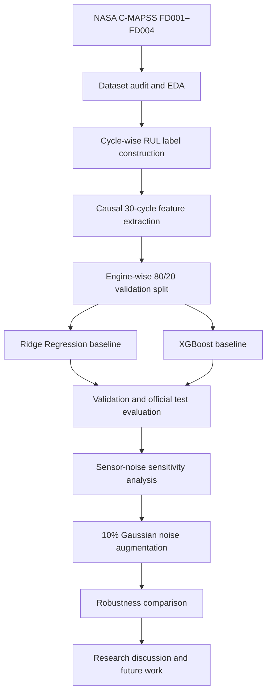

# Final Project Pipeline

## Implemented now
- Dataset inspection and EDA for all four subsets.
- RUL labels and 30-cycle causal rolling features.
- Ridge and XGBoost training on all four subsets.
- Engine-level validation split.
- Official test evaluation at the final observed cycle.
- Feature importance and per-engine prediction exports.
- Five-seed Gaussian sensor-noise sensitivity on FD001 and FD004.
- 10% noise-augmented XGBoost experiment with clean/noisy validation and test evaluation.

## Not yet implemented
- LSTM/GRU/TCN/Transformer benchmark.
- Operating-condition domain adaptation / cross-domain transfer.
- Predictive uncertainty calibration.
- N-CMAPSS external validation.
- Real-world engine maintenance cost model.
